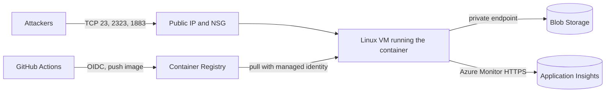

# TelemoqNet

TelemoqNet is an IoT honeypot written in .NET 10. It pretends to be a small BusyBox/Linux
device, lets attackers "log in", and records everything they do (login attempts, commands,
timing, source address) for later analysis. Nothing an attacker types is ever executed:
all device behaviour is simulated in memory and attacker input never causes application-initiated
connections. Production telemetry is sent to the provisioned Application Insights resource.

Status:

| Protocol | State |
| --- | --- |
| Telnet | Implemented (default port 2323) |
| MQTT | MQTT 3.1.1, clean sessions, QoS 0/1 (default port 1883) |

## How it works

1. A listener accepts TCP connections (limited by `Honeypot:MaxConnections`).
2. The Telnet session negotiates options, asks for a login and, if the credentials match the
   configured fake list, starts a simulated shell.
3. Each connection becomes one `HoneypotSession` (logins, commands, ordered events).
4. The session is saved when the connection ends:
   - `Development` / `Local` environment: appended to `data/honeypot-sessions.csv`.
   - Any other environment: one JSON blob per session in Azure Blob Storage,
     under `yyyy/MM/dd/{SessionId}.json`.

See `agents.md` for the code layout and change guidelines.

For the complete Azure and GitHub OIDC setup, see
[docs/azure-github-deployment.md](docs/azure-github-deployment.md).

## Run locally

```bash
dotnet restore TelemoqNet.slnx
dotnet build TelemoqNet.slnx
dotnet run --project TelemoqNet.Api/TelemoqNet.Api.csproj   # Development: CSV storage
```

Connect with `telnet localhost 2323` (or `nc localhost 2323`). The default fake logins are in
`TelemoqNet.Api/appsettings.json`. Run the tests with:

```bash
dotnet test TelemoqNet.IntegrationTests/TelemoqNet.IntegrationTests.csproj
```

## MQTT behavior

The plaintext listener accepts MQTT 3.1.1 (`MQTT`, level 4). MQTT 3.1/5 and
persistent-session requests receive a refusal; QoS 2 publishes close the connection
before routing. Subscriptions requesting QoS 2 can be granted QoS 1. CONNECT,
packet flags, UTF-8 fields, topic filters, and packet IDs are validated against the
[MQTT 3.1.1 specification](https://docs.oasis-open.org/mqtt/mqtt/v3.1.1/os/mqtt-v3.1.1-os.html).

Keepalive, QoS 0/1 Last Will, ordered per-filter SUBACK results, resubscription,
and retained replay are supported. Outgoing QoS 1 IDs remain in flight until PUBACK.
Queue or in-flight exhaustion closes the affected connection and records why.
All session state is discarded at disconnect.

Subscribe to `home/#` for simulated HG-200 gateway metadata and room readings, or
`$SYS/#` for broker metrics. The same fictional device identity is available in
Telnet at `/etc/device-release`. Profile publications are retained independently
of attacker data. Remote retention is disabled by default; enabling
`Honeypot:Mqtt:GlobalAttackerRetainedEnabled` permits bounded, process-local retention.
Live deliveries clear RETAIN; subscription replay sets it. Overlapping filters
produce one live delivery at the highest matching granted QoS.

| MQTT bound | Default |
| --- | --- |
| `Honeypot:Mqtt:OutboundQueueLength` | `64` |
| `Honeypot:Mqtt:MaxInflightMessages` | `64` |
| `Honeypot:Mqtt:MaxRetainedMessages` (per trusted/attacker map) | `256` |

## Configuration

Settings live in `TelemoqNet.Api/appsettings.json` and can be overridden with environment
variables, using `__` for nesting (for example `Honeypot__TelnetPort=2323`).

| Setting | Purpose | Default |
| --- | --- | --- |
| `Honeypot:TelnetPort` | TCP port the app listens on | `2323` |
| `Honeypot:MaxConnections` | Concurrent session limit | `100` |
| `Honeypot:SessionTimeoutSeconds` | Per-session timeout | `300` |
| `Honeypot:MaxAuthenticationAttempts` | Login attempts per session | `3` |
| `Honeypot:CapturePasswords` | Store attempted passwords in the session | `false` |
| `Honeypot:Credentials` | Fake `user:password` pairs that log in | see file |
| `AzureStorage:Container` | Blob container for sessions | `honeypot-sessions` |
| `AzureStorage:AccountUrl` | Blob account endpoint used with the managed identity | unset |
| `LocalStorage:CsvPath` | CSV path in Development | `data/honeypot-sessions.csv` |

Never put secrets in tracked JSON. Use user secrets or environment variables.

## Cloud structure (Azure)

The infrastructure is defined with Terraform in `infra/` and lives in its own dedicated
Azure subscription, separate from anything else you run.



| Resource | Role |
| --- | --- |
| Resource group, VNet `10.50.0.0/24` | One honeypot subnet and one private-endpoint subnet |
| NSG | Inbound only TCP 23, 2323, 1883. Outbound denied except Azure Monitor (plus a temporary bootstrap rule) |
| Static public IP | The address attackers see |
| Linux VM (Ubuntu 24.04) | Runs the honeypot container with Docker; port 23 and 2323 map to the app's 2323, 1883 to 1883 |
| User-assigned identity (VM) | Pulls images and writes session blobs, nothing else |
| Container Registry (Premium) | Holds one image per release; the VM pulls through an ACR private endpoint |
| Storage account | No public access, no shared keys, reached through a Blob private endpoint |
| Log Analytics + Application Insights | Production application logs and telemetry; VM egress is limited to the Azure Monitor service tag |
| Custom role "log writer" | Write-only on the sessions container: cannot read, list or delete |
| GitHub identity + federated credential | Lets the `prod` GitHub environment push images and run commands on this one VM, with no stored secrets |

There is no inbound SSH. The VM is managed with `az vm run-command` only.

## Deploy

The deployment flow below has been validated against the Azure for Students subscription used
for this project. The current deployment uses `austriaeast` and a `Standard_B2ats_v2` VM.

Prerequisites: a dedicated Azure subscription, Azure CLI, Terraform 1.9 or newer, Docker, and
this repository on GitHub.

### 1. Provision the infrastructure

```bash
az login
az account set --subscription <honeypot-subscription-id>
cd infra
cp terraform.tfvars.example terraform.tfvars    # fill in subscription, repo, SSH public key
terraform init
terraform validate
terraform plan
terraform apply
```

Keep `allow_bootstrap_egress = true` (the default) for this first apply so the VM can install
Docker on first boot. Note the outputs: `acr_name`, `acr_login_server`, `public_ip`, `vm_name`,
`resource_group`, `github_client_id`, `tenant_id`.

### 2. Wait for first boot, then close the bootstrap egress

```bash
az vm run-command invoke -g <resource_group> -n <vm_name> \
  --command-id RunShellScript --scripts "cloud-init status --wait"
```

Then set `allow_bootstrap_egress = false` in `terraform.tfvars` and run `terraform apply` again.
This removes the VM's general outbound internet access.

### 3. Build and push the image

```bash
az acr login --name <registry-name>
docker build -f TelemoqNet.Api/Dockerfile -t <acr_login_server>/telemoqnet:<tag> .
docker push <acr_login_server>/telemoqnet:<tag>
```

Use the git commit SHA as the tag.

### 4. Deploy to the VM

```bash
az vm run-command invoke -g <resource_group> -n <vm_name> \
  --command-id RunShellScript --scripts "/opt/honeypot/deploy.sh <tag>"
```

`deploy.sh` signs in to the registry with the VM identity, pulls the image and restarts the
container (read-only filesystem, all capabilities dropped, memory and process limits).

### 5. Verify

```bash
az vm run-command invoke -g <resource_group> -n <vm_name> \
  --command-id RunShellScript --scripts "docker ps; docker logs --tail 50 honeypot"
telnet <public_ip> 23
```

Log in with one of the configured fake credentials, run a command, disconnect, and confirm a
blob appears in the sessions container. The storage account has no public access, so reading
logs requires `log_reader_principal_id` to be set for a read-only Entra assignment and a
private-network path into the VNet.

### Releasing and rolling back

A new release is a push to `main`; the workflow tags the image with that
commit SHA and deploys it. Terraform is only needed when the infrastructure
changes. After the `prod` environment variables are configured, GitHub Actions
authenticates with the OIDC identity (`github_client_id`, `tenant_id` and the
subscription ID go in as repository environment variables, not secrets).

### Patching and teardown

The VM has no general internet access, so OS updates need `allow_bootstrap_egress = true`
temporarily (or a rebuilt VM). `terraform destroy` removes everything and stops the costs.
Collected logs are deleted with the storage account, so export what you need first.

## Known gaps

- A private-network access method for human log analysis (for example VPN or a controlled jump host)
  is not provisioned by this module. The VM's write-only identity can persist sessions but cannot
  list or read them.

## Safety and data

- Run it only in the dedicated subscription, never in a work or shared one.
- Source IP addresses are personal data under GDPR. Restrict access to the logs, set a
  retention limit, and publish aggregates instead of raw addresses.
- Do not commit credentials, captured attacker data, Terraform state or `terraform.tfvars`.
